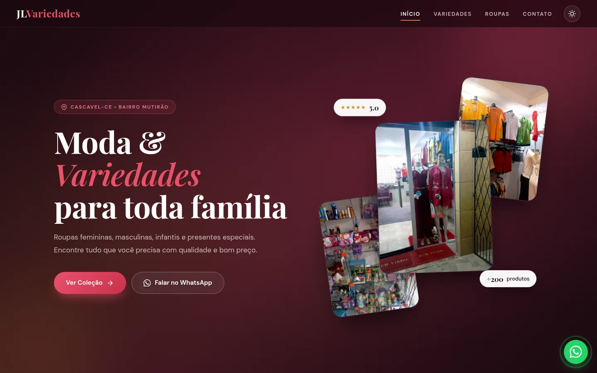
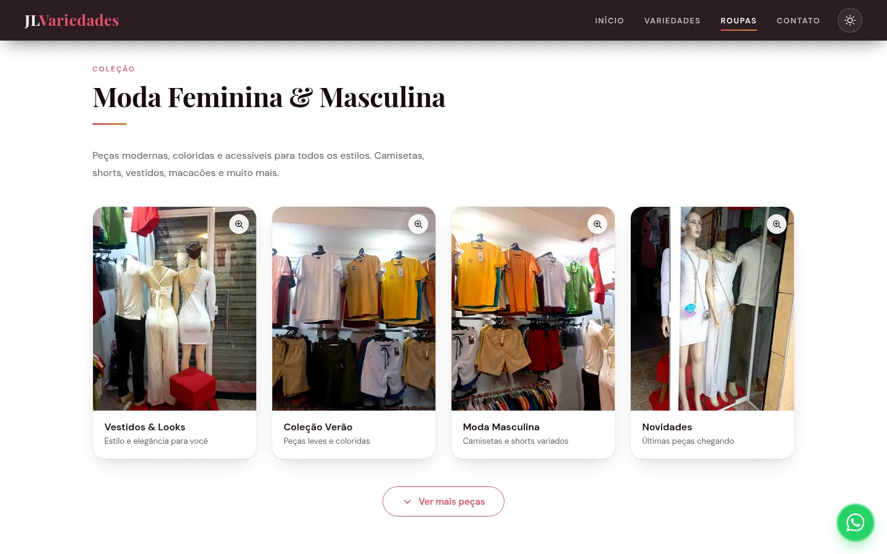

# JL Variedades



**Site:** https://hriel123.github.io/jlvariedades-/

Site da JL Variedades, loja de moda e variedades no Bairro Mutirão, em Cascavel-CE. Apresenta a loja, os produtos (com fotos reais) e leva o cliente direto para o WhatsApp para fazer pedidos.

## Seções

- **Início:** apresentação da loja, com acesso à coleção e ao WhatsApp.
- **Sobre:** a loja e o atendimento em Cascavel.
- **Variedades & Presentes:** kits, presentes e variedades em geral.
- **Moda Feminina & Masculina:** coleção de roupas, com o botão "Ver mais peças".
- **Avaliações:** o que os clientes dizem.
- **Contato:** WhatsApp, e-mail e mapa da loja.



## Recursos

- Fotos ampliadas ao clicar (lightbox), com setas (ou deslizando no celular) para passar as fotos da seção, fechando com clique fora ou Esc
- Modo escuro, com a escolha salva no navegador
- Botão flutuante do WhatsApp
- Menu para celular e layout responsivo
- Fotos em WebP em dois tamanhos: uma menor para os cards e a maior só ao ampliar, para o site carregar rápido no celular

## Tecnologias

HTML, CSS e JavaScript puros, sem frameworks. Hospedado no GitHub Pages.

## Estrutura

```
index.html   página (estilos e scripts principais embutidos)
style.css    estilos
script.js    interações (como o "Ver mais peças")
fotos/       fotos dos produtos: <nome>-card.webp (cards) e <nome>.webp (ampliada)
docs/        imagens deste README
```

### Adicionar uma foto nova

Converter a foto para WebP nos dois tamanhos (lado maior com 1000px para o card e 1800px para a ampliada), salvar em `fotos/` e usar no card:

```html

```

## Autor

Hariel Silva Fabrício · [Portfólio](https://hriel123.github.io/Portifolio/) · [GitHub](https://github.com/hriel123)
